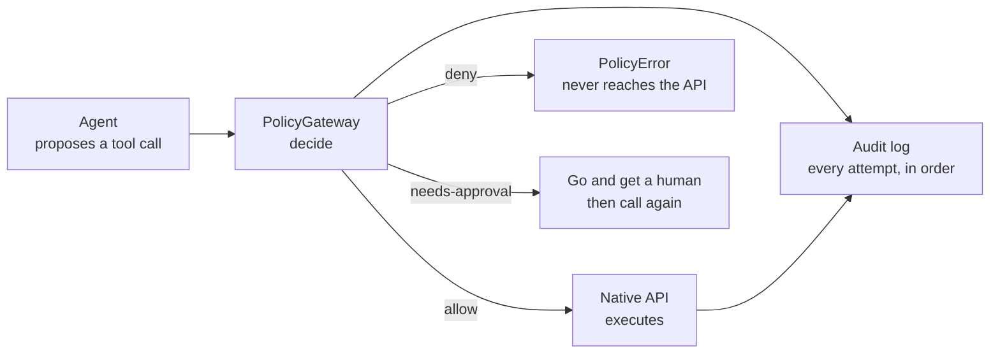

# agent-policy-gateway

**Your AI agent can call the API. That doesn't mean it should be allowed to.**

Give an agent a direct API key and it can issue a $10,000 refund nobody
approved — and the API will happily return 201, because API-key auth
only proves *who* is calling, never *whether the call is okay*.
Authentication isn't authorization. The agent proposes; the system
decides.

This is a small, deterministic policy gateway that sits between an
agent and the tools it wants to call. Before anything executes, it
answers one question with one of three verdicts — **allow**, **deny**,
or **needs-approval** — and writes every attempt to an audit log.

No dependencies. No API key. No network. Just Python 3.10+.

## Run it in 10 seconds

```bash
git clone https://github.com/kbsai777/agent-policy-gateway.git
cd agent-policy-gateway
python demo.py
```

The demo runs the same calls two ways — straight at the API, then
through the gateway — so you can see the difference instead of taking
my word for it:

```text
=== 1. Direct: the agent holds the API key ===

  refund $24.50 on A-103: 201 {'order_id': 'A-103', 'amount': 24.5, 'status': 'refunded'}
  refund $10,000 on A-103, nobody approved it: 201 {'order_id': 'A-103', 'amount': 10000, 'status': 'refunded'}
  transfer $5,000 to a blocked account: 201 {'from_account': 'ACCT-OPERATING', 'to_account': 'ACCT-BLOCKED', 'amount': 5000, 'status': 'transferred'}
  Audit trail of who did what and why: none
  What the API actually did: 2 refunds, 1 transfers

=== 2. Behind the gateway: refunds ===

  refund $24.50, no approval: DENIED -- needs-approval: create_refund has side effects and needs approval
  refund $10,000, approved: DENIED -- deny: refund amount 10000 exceeds order total 24.5 for order A-103
  refund $24.50, approved, support role: 201 {'order_id': 'A-103', 'amount': 24.5, 'status': 'refunded'}
  Refunds the API actually processed: 1
```

Then transfers (caps, a deny-list, a daily budget) and a data purge
(admin-only, protected customers), unknown tools denied by default,
and the full audit log at the end. The whole output is in
[`demo.py`](demo.py) — what you see above is what it prints.

Tests:

```bash
python -m unittest discover -s tests -v   # 22 tests
```

## How it works



The gateway never re-implements the API. It only stands in front of
it. The API in this repo is a small in-process mock (`policy_gateway/api.py`)
with local data — orders, accounts, customers — so everything runs
offline.

Every call goes through the same checks, in the same order:

1. **Unknown tool → deny.** The gateway is an allow-list. If it doesn't
   know the tool, the answer is no.
2. **Role → deny.** Each tool lists the roles that may call it. A
   support agent can't purge customer data, approval or not.
3. **Deny-list → deny.** Blocked values — sanctioned accounts, for
   example — are refused no matter who asks.
4. **Amount cap → deny.** Some numbers are never sane. A $5,000
   transfer against a $1,000 cap fails even with approval.
5. **Custom rule check → deny.** The escape hatch for business rules
   that don't fit the fields above, like "a refund can't exceed the
   order's total" or "today's transfers can't pass $2,000".
6. **Approval → needs-approval.** The call is fine except nobody has
   signed off yet. This is a pause, not a refusal.
7. **Otherwise → allow.**

The order matters: checks 2–5 run *before* the approval check, so an
approval can never rescue a call that is wrong on its merits. That is
the $10,000 refund lesson — "someone approved it" is not a defence
when the amount itself is absurd.

## What the gateway checks

The default policy (`policy_gateway/rules.py`) covers four tools with
three different risk profiles:

| Tool | Approval | Roles | Limits |
| --- | --- | --- | --- |
| `get_order` | no | any | read-only |
| `create_refund` | yes | support, finance | refund ≤ order total |
| `transfer_funds` | yes | finance | ≤ $1,000 per transfer, ≤ $2,000/day, never to a blocked account |
| `purge_customer_data` | yes | admin | never a protected customer |

## How to add a rule

Rules are data, not code paths. To govern a new tool, add one `Rule`
to `DEFAULT_POLICY` in `policy_gateway/rules.py`:

```python
from policy_gateway.rules import DEFAULT_POLICY, Rule

MY_POLICY = DEFAULT_POLICY + (
    Rule(
        tool="issue_credit",
        requires_approval=True,
        allowed_roles=("finance",),
        max_amount=500,
        blocked_values={"to_account": {"ACCT-BLOCKED"}},
    ),
)

gateway = PolicyGateway(api, API_KEY, policy=MY_POLICY)
```

If your rule doesn't fit those fields, pass a `check` — a small
function that takes the call's arguments and returns a reason string
to deny, or `None` to pass:

```python
def _no_weekend_payouts(arguments):
    if arguments.get("day") in ("Saturday", "Sunday"):
        return "payouts don't run on weekends"
    return None

Rule(tool="issue_payout", requires_approval=True, check=_no_weekend_payouts)
```

Then use the gateway the same way everywhere:

```python
from policy_gateway import PolicyError, PolicyGateway

gateway = PolicyGateway(api, API_KEY)

try:
    status, body = gateway.call_tool(
        "create_refund", order_id="A-103", amount=24.50,
        approved=True, role="support",
    )
except PolicyError as exc:
    print("refused:", exc)

# Or decide without executing, e.g. to ask a human first:
decision = gateway.decide(
    "create_refund", {"order_id": "A-103", "amount": 24.50},
    actor="support", approved=False,
)
print(decision.verdict)   # Verdict.NEEDS_APPROVAL
```

## What I learned building this

- **Auth ≠ authorization.** The mock API authenticates callers
  perfectly and still can't express "refunds need a second pair of
  eyes." That gap is what justifies a layer in front of it — not
  protocol fashion, not architecture taste.
- **Approval is the weakest check, so it runs last.** If the amount is
  absurd or the account is blocked, the answer is no regardless of
  who signed off. Putting approval first would have let a rubber
  stamp override every other rule.
- **Deny by default is the only safe default.** The gateway knows four
  tools. Everything else — including tools invented after the policy
  was written — gets a no until someone writes a rule for it.
- **The audit log is the feature, not the garnish.** When a refund
  goes wrong in production, the question is never "did we have a
  policy?" but "who approved this, and what did they see?" Every
  attempt, including the denied ones, is one line in the log with
  the reason attached.

## Limits

This is a teaching demo, not production infrastructure. The "API" is
an in-process stand-in, not a real service; approval is a boolean, not
a real consent flow; the audit log lives in memory; the daily transfer
total resets when the process exits. A production version would need
real transport (an MCP server or a UTCP client), identity-aware
approvals, a durable audit store, and rate limits. The point here is
the shape of the decision, which survives all of that.

This project grew out of a LinkedIn lab entry comparing MCP and UTCP
([linkedin-ai-lab, 2026-11-02-mcp-vs-utcp](https://github.com/kbsai777/linkedin-ai-lab/tree/main/entries/2026-11-02-mcp-vs-utcp)),
where the same $10,000 refund demo first showed why a wrapper earns
its keep. The gateway is that wrapper, graduated into its own repo.

## License

MIT — see [LICENSE](LICENSE).
